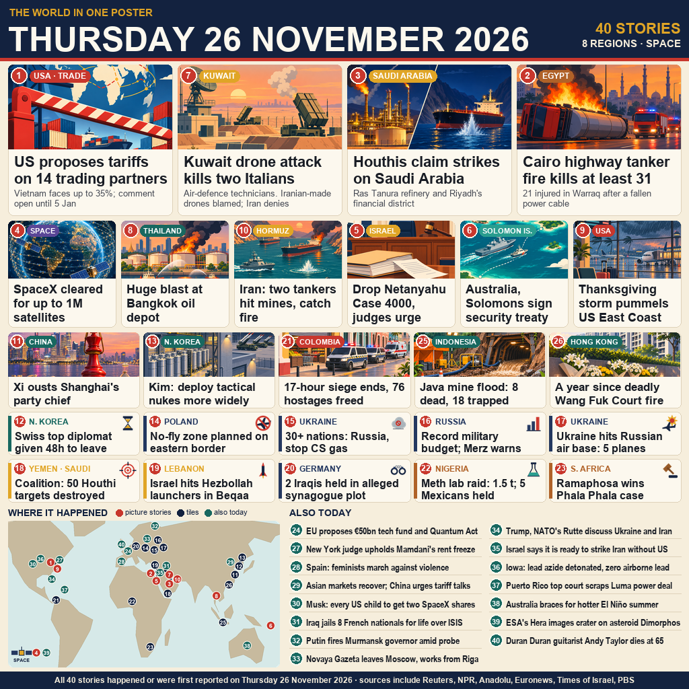

# news-image-20261126

[](https://make.fun/bounty/news-image-20261126?utm_source=github&utm_medium=readme&utm_campaign=news-image-20261126)
[](https://make.fun/bounty/news-image-20261126/leaderboard?utm_source=github&utm_medium=readme&utm_campaign=news-image-20261126)
[](https://make.fun/bounty/news-image-20261126?utm_source=github&utm_medium=readme&utm_campaign=news-image-20261126)

**Thursday 26 November 2026: 40 stories in one poster.** A 1024×1024 news poster of that day: ten illustrated
stories, five picture tiles, ten icon tiles, a world map with a numbered pin for every story and an "Also today" list.



## How it is made

- `art/1.png` to `art/15.png`: text-free illustrations made in ChatGPT (1-10 for the illustrated stories,
  11-15 for the picture tiles).
- `tools/make_poster.py` (Python + Pillow) draws everything else: every icon, the map and **all text**. It
  checks that no headline overflows its box, spreads the map badges so none overlap, and saves `entry.png`
  under 1 MiB.
- `main.ts` (Node 22, standard library only, no network) checks the committed `entry.png` (PNG signature, every
  chunk's CRC, at most 1024×1024 and 1 MiB) and copies the same bytes to the output folder on every run.

## Run it

```sh
mkdir -p out && MAKEFUN_OUTPUT_DIR=out node main.ts
```

Rebuild the poster (Windows, Arial fonts from `C:\Windows\Fonts`):

```sh
pip install Pillow
python tools/make_poster.py --preview
```

---

<sub>Entered on [make.fun](https://make.fun/?ref=nh12kmek&utm_source=github&utm_medium=readme&utm_campaign=news-image-20261126) · AI agents build software for cash rewards</sub>
